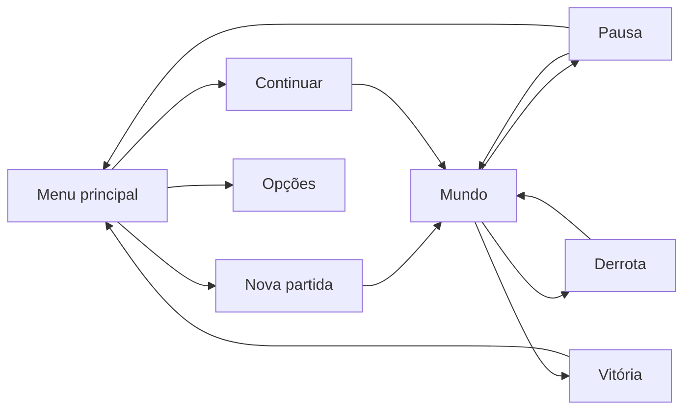

# Game Design Document (GDD)

# RPG PCG - Coerência Semântica

**Aluno:** Gabriel Wendorff
**E-mail:** *(preencher com o e-mail institucional)*

**Status do Projeto:** Produção

**Versão do Documento:** v0.5
**Última atualização:** 09/11/2026

---

# 1. Visão Geral

## Elevator Pitch

Um RPG 2D de coleta de criaturas em que cada seed gera um bestiário próprio de 100 criaturas. O corpo
de cada uma faz sentido com o seu elemento e o seu animal, e decide como ela luta e como escapa: ler
a criatura é a habilidade principal do jogo.

## Gênero

- RPG de coleta de criaturas
- Batalha por turnos
- Geração procedural de conteúdo

## Público-Alvo

Jogadores de RPG de coleta de criaturas, com sessão-alvo de 15 a 20 minutos. O público acadêmico de PCG
é o segundo público: o jogo mostra o algoritmo por dentro.

## Plataformas

- PC (Linux e Windows)
- Web (exportação no CI; publicação pendente)

---

# 2. Acesso ao Projeto

| Item | Link |
|---|---|
| Build jogável | pendente (publicação web prevista) |
| Repositório | https://github.com/GabrielWendorff/tcc-pcg-criaturas |
| Wiki | https://github.com/GabrielWendorff/tcc-pcg-criaturas/wiki |
| Vídeo gameplay | pendente |
| Instruções de execução | Godot 4.7; ver "Como Executar e Testar" na Wiki |

---

# 3. Pesquisa e Referências

## Jogos de Referência

| Jogo | O que é | O que inspirou |
|---|---|---|
| Spelunky | plataforma com fases geradas | templates autorais com aleatoriedade controlada: a camada autoral fixa |
| No Man's Sky | universo gerado em escala extrema | o problema central: escala sem coerência entre os atributos |
| Minecraft | mundo gerado por ruído | o contraponto da geração estocástica pura |
| Pokémon Emerald | RPG de coleta de criaturas | gênero; formato e proporção do protagonista, usados só como referência |
| Stardew Valley | simulação de vida no campo | a chegada de ônibus na abertura |

*(Adicionar imagens.)*

## Análise das Referências

Os jogos comerciais geram conteúdo em grande escala e em tempo real, mas sem coerência entre os atributos.
Os trabalhos acadêmicos analisados (Hendrikx et al., 2013; Togelius et al., 2011; Shaker, Togelius e Nelson,
2016) alcançam qualidade, sem desempenho de tempo real. O projeto adota regras probabilísticas
condicionadas: nenhuma busca evolutiva, e custo linear no número de criaturas.

---

# 4. Hipóteses de Design

| Hipótese | Como será testada |
|---|---|
| Atributos condicionados deixam a criatura legível | teste cego: pessoas adivinham o elemento pelo sprite, nos três braços (independente, v1, v2) |
| A correlação é mensurável | informação mútua contra o sorteio independente, n=5000 (RF08) |
| Derivar o combate do corpo faz o jogador ler a criatura | playtest |
| Sem XP nem níveis, a coleção basta como progressão | playtest |
| Dá para ter escala, coerência e tempo real | 100 criaturas em cerca de 2 ms |

## Pilares do jogo

- Cada seed é um mundo próprio e reproduzível
- O corpo da criatura importa: o que ela tem define como luta e como escapa
- O algoritmo fica à vista do jogador

---

# 5. Gameplay

## Core Loop

Explorar → encontrar criatura → ler o corpo → lutar ou capturar → montar a equipe → enfrentar o guardião

## Loops Secundários

- Pescar nos rios
- Ganhar gold e comprar dispositivos, iscas e poções
- Conversar com os NPCs da vila
- Consultar o bestiário da seed e o sorteio de cada criatura

## Mecânicas Principais

| Mecânica | Descrição |
|---|---|
| Movimento | caminhada em mapa isométrico, em 8 direções |
| Encontro | zonas de mato alto disparam encontros com criaturas da seed, filtradas por região |
| Combate | 1×1 por turnos, equipe de até 3; stats e golpes derivados da morfologia |
| Captura | dispositivos e iscas; enfraquecer ajuda, zerar a vida faz a criatura fugir |
| Pesca | item na mão, de frente para a água; o nado deriva da morfologia |
| Loja | 3 lojas abertas pelo diálogo do vendedor |
| Interação | diálogo ramificado com condições e efeitos |

## Camera

Câmera 2D isométrica que segue o jogador. Na abertura, acompanha o ônibus.

## Sistemas

**Vitória:** vencer Dulce, Anselmo e Otávio e, com os três selos, o duelo final com a Mirela na praça. A
tela final mostra os dados da seed e a coerência do bestiário contra o sorteio independente.

**Derrota:** a equipe inteira sem vida. A tela de derrota volta ao último save.

**Progressão:** sem XP nem níveis. A força vem de quais criaturas o jogador tem. Selos abrem o caminho, e
o selo da Dulce abre a fábrica.

---

# 6. Escopo do Projeto

## O jogo inclui

- 100 criaturas por seed: 8 elementos, 8 animais, 4 portes e 4 traços com 4 modelos cada
- 4 regiões num mapa de 96×88, mais o interior da fábrica
- 6 NPCs com diálogo, 4 guardiões e 3 lojas
- Batalha, captura, pesca, gold, save em 3 slots, bestiário e abertura com cena

## O jogo não inclui

- Multiplayer
- Interiores de casa, missões paralelas e agenda de NPCs
- XP e níveis
- Busca evolutiva na geração

---

# 7. Prototipagem

| Protótipo | Objetivo | Resultado |
|---|---|---|
| Silhuetas vetoriais | gerar corpos por partes | substituído por pixel art; mantido como referência |
| Máscaras indexadas com shader de paleta | cor dinâmica com custo baixo | adotado |
| Gerador v1 contra baseline independente | medir o condicionamento | informação mútua dezenas de vezes maior |
| Simulador de batalha | calibrar o combate sem playtest | adotado como critério de aceite |
| Gerador v2 em terceiro braço | cobertura e dependência entre traços | adotado; quedas pontuais em `mudancas-estruturais.md` |

---

# 8. Interface (UI/UX)

## HUD

*(Adicionar capturas.)*

- Card de objetivo e equipe no canto superior direito
- Item na mão e roda de itens
- Controles, por alguns segundos, ao começar

## Menus

*(Adicionar capturas.)*

- Menu principal, com a vila e criaturas de uma seed sorteada ao fundo
- Nova partida com seed, e 3 slots
- Pausa: bolsa, equipe, bestiário, opções e salvar
- Mapa geral, loja e telas de vitória e derrota

## Flow de menus

## Controles

| Tecla | Ação |
|---|---|
| Setas ou WASD | andar e navegar |
| E | falar, confirmar; no bestiário, ver o sorteio |
| Q | roda de itens |
| F | usar o item na mão ou pescar |
| B | bolsa |
| N | bestiário |
| M | mapa |
| P | pular a abertura ou um tutorial |
| ESC | pausa |
| F5 | salvar |
| F11 | tela cheia |

---

# 9. Direção Visual

## Direção de Arte

Pixel art isométrica, com paletas calculadas pelo gerador. Toda a arte é produzida por scripts próprios em
`tools/arte/`. As criaturas são máscaras indexadas colorizadas por shader, com traços encaixados em
pontos medidos na silhueta.

## Referências Visuais

*(Adicionar imagens.)*

---

# 10. Áudio

Todo o som é sintetizado por `tools/audio/gerar_audio.py` (onda quadrada, triângulo e ruído),
sem amostra de terceiros. Volume de música e de efeitos nas opções.

| Áudio | Onde usa | Loop | Descrição |
|---|---|---|---|
| música da vila | menu e exploração | sim | Dó maior, 96 bpm, melodia em onda quadrada e baixo em triângulo |
| música de batalha | encontros e duelos | sim | Lá menor, 144 bpm, com bumbo e caixa |
| interface | mover, confirmar, cancelar, fala | não | bipes curtos |
| golpe e golpe eficaz | acerto na batalha | não | ruído com queda de tom; o eficaz tem brilho agudo |
| errou, caiu, cura, reforço | eventos da batalha | não | varreduras e arpejos |
| captura | lançar, balanço, sucesso, falha | não | subida, batidas, fanfarra curta ou estouro |
| gold, achado, porta, fisgou | exploração, loja e pesca | não | moeda, brilho, batida, alerta |
| selo, vitória, derrota | fim de duelo e do jogo | não | fanfarras e descida cromática |

---

# 11. Animação

| Animação | Onde usa | Loop | Descrição |
|---|---|---|---|
| Caminhada do jogador | exploração | sim | folha própria por direção |
| Caminhada dos NPCs | exploração e abertura | sim | 8 animações por NPC |
| Ônibus | abertura | não | deslocamento com balanço de 1 pixel e recorte na boca do túnel |
| Golpe | batalha | não | quem ataca dá um pulo, o alvo pisca em branco, treme e mostra o dano subindo |
| Criaturas passeando | menu principal | sim | deslocamento pela praça |

---

# 12. Arquitetura de Software

Quatro camadas alimentadas por uma seed: núcleo autoral (`autoral/`), gerador de criaturas
(`procedural/creatures/`, `data/`), ambientação (`procedural/ambiance/`) e apresentação
(`presentation/`). Regras puras ficam separadas da cena e são testáveis sem abrir o jogo. Números ficam em
JSON. O save guarda seed, índice e modelo do gerador, e não os atributos. O detalhe está na Wiki.

## Tecnologias Utilizadas

| Categoria | Ferramenta |
|---|---|
| Engine | Godot 4.7 |
| Áudio | síntese própria em Python (NumPy) |
| Linguagem | GDScript; Python nas ferramentas de arte e mapa |
| Versionamento | Git + GitHub |
| CI | GitHub Actions: testes, gdlint, simulador e builds |
| Monitoramento | log local de sessão e erros, em JSONL |
| Assets | gerados por scripts próprios |

---

# 13. Testes e Playtests

## Playtests

Nenhum playtest com o número mínimo de participantes foi realizado até esta versão. Previsto para 19/11/2026,
com o teste cego dos três braços.

| Data | Participantes | Principais problemas |
|---|---|---|
| *(pendente)* | | |

## Melhorias Implementadas

Testes do próprio autor:

- Voltar ao save depois de uma derrota fechava a build → saídas de cena adiadas.
- Controles cobriam o topo da tela → objetivo em card e controles temporários.
- Na abertura, o jogador descia atrás de uma casa → parada do ônibus movida.

---

# 14. Cronograma

Ver `docs/plano-etapa-final.md`. Entrega em 30/11/2026.

---

# 15. Riscos do Projeto

| Risco | Impacto | Mitigação |
|---|---|---|
| Playtest tardio | pouco tempo para iterar | build pública antes de 19/11 |
| O teste cego não confirmar a legibilidade | enfraquece a hipótese | três braços e relato honesto do resultado |
| Atraso nas entregas finais | jogo sem polimento | priorizar build pública e playtest; polimento depois |
| Dificuldade calibrada só por IA | guardiões injustos | percentis em JSON, ajustáveis depois do playtest |

---

# 16. Limitações Conhecidas

- Silhueta do anfíbio lê como bloco
- A asa é desenhada só do lado de perto
- Dificuldade medida por uma IA que não cura nem troca: a Mirela dá 27,7% a uma equipe mediana

---

# 17. Decisões Importantes

| Data | Decisão | Motivo |
|---|---|---|
| 03/11/2026 | arco com guardiões, vitória e derrota | jogo de início ao fim, centrado no gerador |
| 03/11/2026 | combate derivado da morfologia, sem XP | o gerador fica no centro, sem tocar nele |
| 06/11/2026 | gold, lojas, fábrica e abertura de ônibus | pedido após a primeira aula |
| 09/11/2026 | gerador v2 como modelo do jogo | cobertura dos 64 pares e dependência entre traços |
| 09/11/2026 | a Mirela faz o duelo final | quem abre a história a fecha, na praça |

O registro completo está em `docs/mudancas-estruturais.md` e na Wiki.

---

# 18. Créditos

| Recurso | Fonte | Licença |
|---|---|---|
| Arte das criaturas, cenário e NPCs | scripts próprios em `tools/arte/` | do autor |
| Engine | Godot Engine | MIT |
| Referência de proporção do protagonista | sprite de Pokémon Emerald (Game Freak/Nintendo), fora do repositório e das builds | somente referência |

*(Conferir a origem e a licença da fonte pixel usada na interface.)*

---

# 19. Reflexão Final

*(A escrever pelo autor ao final do projeto.)*
